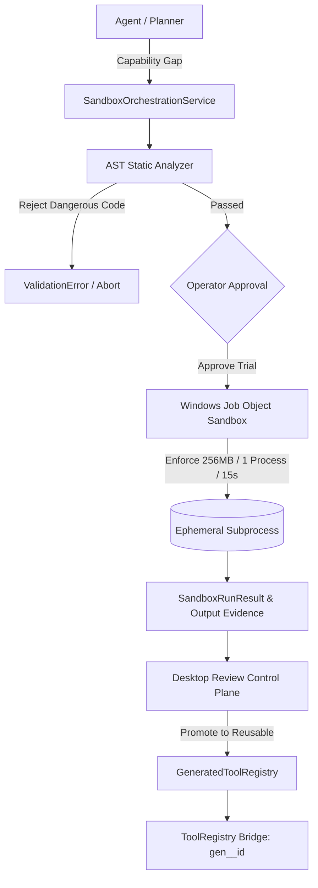

# NEXORA — Phase 10: Generated Tools and Sandbox Implementation Specification

## 1. Executive Summary & Purpose

Phase 10 delivers a secure, contained **Capability Synthesis and Sandbox Isolation Platform** into NEXORA. It enables agents to propose custom Python tools when no existing tool or MCP capability solves a task, verifies them through deep AST static analysis, executes them within a kernel-constrained Windows Job Object sandbox, and allows operators to promote validated tools to persistent, versioned `ToolRegistry` capabilities with complete audit provenance and rollback controls.

---

## 2. Core Constraints & Guarantees

1. **Zero Backend Process Execution:** Generated tool code NEVER executes inside the FastAPI server process or with ambient user permissions.
2. **Win32 Job Object Kernel Containment:** Every sandbox execution is bound to a Windows Job Object (`kernel32.dll`) enforcing hard constraints:
   * **RAM Limit:** 256 MB (`JOB_OBJECT_LIMIT_PROCESS_MEMORY`).
   * **Process Limit:** Max 1 active process (`JOB_OBJECT_LIMIT_ACTIVE_PROCESS`, blocking fork bombs).
   * **Guaranteed Cleanup:** `JOB_OBJECT_LIMIT_KILL_ON_JOB_CLOSE` ensures child processes are terminated by the OS if parent fails or task cancels.
3. **AST Static Security Analyzer:** Parses Python source into an AST before sandbox launch. Disallows forbidden builtins (`eval`, `exec`, `compile`, `globals`, `locals`, `__import__`), dunder introspection escapes (`__subclasses__`, `__mro__`), and restricts imports strictly to an approved standard library whitelist (`math`, `re`, `json`, `csv`, `datetime`, `collections`, `itertools`, `hashlib`, `urllib.parse`, `string`, `typing`, `pydantic`, `random`, `uuid`, `base64`, `dataclasses`).
4. **Environment Scrubbing & Denied Network:** Subprocesses run with a completely stripped environment (no API keys, tokens, or system paths) and zero network access.
5. **Two-Phase Lifecycle:**
   * *Phase 1 (Trial Run):* Disposable run in `data/sandbox/<run_id>/` executing positive/negative tests; working folder forcefully wiped on exit.
   * *Phase 2 (Promotion):* Explicit operator action promotes tool to `data/tools/generated/<id>/<version>/` and mounts it in `ToolRegistry` under `gen__<tool_name>` with disable/rollback capability.
6. **No Arbitrary Package Installation:** Running `pip install` inside the sandbox is strictly barred.

---

## 3. Decision Log

| ID | Decision | Alternatives Considered | Rationale |
| :--- | :--- | :--- | :--- |
| **D1** | Windows Job Object native runner as core isolation baseline | Pure virtualenv subprocess; Full VM / Windows Sandbox (.wsb) | Enforces true OS kernel-level memory (256MB) and process limits (`ActiveProcessLimit=1`, `KillOnJobClose`) without VM boot latency or external prerequisites. |
| **D2** | Pure Python 3 language target with strict import allowlist | Multi-language (Node.js, Rust, Go, PowerShell) | Python is the native runtime of NEXORA's backend, enabling deep AST inspection and seamless `BaseTool` reflection. |
| **D3** | Strict AST allowlist for standard data/math libraries | Running arbitrary pip packages; Heuristic regex code filtering | AST analysis is deterministic and syntax-aware (cannot be bypassed by string manipulation or comments); restricting to pure data/math modules eliminates 99%+ of system attack vectors. |
| **D4** | AST-level blocking of dunder introspection attributes | Runtime exception hooks; Post-execution auditing | Python sandbox escapes historically exploit `().__class__.__base__.__subclasses__()` to recover `os.system`; catching these at AST parse time stops the exploit before any bytecode runs. |
| **D5** | Windows Job Object with `KillOnJobClose` and `ActiveProcessLimit=1` | Pure `subprocess.Popen` timeout; psutil process kill | Win32 Job Objects are enforced by the Windows NT kernel itself, guaranteeing child processes cannot escape or survive parent crashes even if they spawn runaway threads or fork. |
| **D6** | Total environment variable scrubbing | Inheriting `os.environ.copy()` | Prevents generated code from accessing sensitive secrets (`GITHUB_TOKEN`, `ANTHROPIC_API_KEY`, Windows user profile paths) through environment inspection. |
| **D7** | JSON file contract (`input.json` / `output.json`) | Inter-process pipes / IPC socket | Cleanest process boundary. Zero reliance on network sockets or stdin/stdout framing, which can be hijacked by print statements or encoding errors. |
| **D8** | Mandatory positive and negative test cases in manifest | Running code blind without pre-execution tests | Forces model to define falsifiable assertions before execution, preventing trivial crashes or infinite loops during task execution. |
| **D9** | Namespacing promoted tools as `gen__<tool_name>` | Overwriting core tools; Random UUID names | Clear namespacing prevents collision with built-in (`fs_*`, `terminal_*`) or MCP (`mcp__*`) tools while keeping identifiers human-readable in LLM planning. |
| **D10** | Immutable SHA-256 version binding in `manifest.json` | Mutable script files | Guarantees that the code running in production is bit-for-bit identical to the code reviewed and tested in the sandbox. Any tampering invalidates the capability. |

---

## 4. Architecture & Module Design

```
backend/app/sandbox/
├── __init__.py
├── models.py               # Domain models: GeneratedToolProposal, ToolManifest, SandboxPolicy, SandboxRunResult
├── validator.py            # AST Static Security Analyzer (import allowlist, syntax, dangerous call checker)
├── entrypoint.py           # Hardened sandbox child process entrypoint script
├── runners/                # Pluggable sandbox runners
│   ├── __init__.py
│   ├── base.py             # Abstract SandboxRunner interface
│   ├── job_object.py       # Windows Win32 Job Object runner (kernel memory, CPU, PID bounds)
│   └── docker.py           # Optional Docker container runner (--network none, read-only)
├── evidence.py             # Sandbox execution evidence recorder (data/sandbox/runs/<run_id>.json)
├── registry.py             # Versioned generated tool catalog (data/tools/generated/<id>/<version>/)
├── bridge.py               # Dynamic BaseTool wrapper integrating approved tools into central ToolRegistry
├── service.py              # SandboxOrchestrationService coordinating validation, execution, and review
└── router.py               # FastAPI endpoints for proposal validation, trial runs, review, and promotion
```



---

## 5. Domain Models (`backend/app/sandbox/models.py`)

```python
class TestCase(BaseModel):
    name: str
    inputs: dict[str, Any]
    expected_output: Any
    is_negative: bool = False

class GeneratedToolManifest(BaseModel):
    name: str = Field(..., pattern=r"^[a-z0-9_]+$")
    version: str = "1.0.0"
    description: str
    input_schema: dict[str, Any]
    output_schema: dict[str, Any]
    test_cases: list[TestCase] = []
    source_sha256: str
    created_at: str

class GeneratedToolProposal(BaseModel):
    name: str
    description: str
    code: str
    input_schema: dict[str, Any]
    output_schema: dict[str, Any]
    test_cases: list[TestCase]
    task_id: Optional[str] = None

class SandboxRunResult(BaseModel):
    run_id: str
    task_id: Optional[str]
    tool_name: str
    status: str  # TESTS_PASSED, TESTS_FAILED, TIMEOUT, OOM_KILLED, EXECUTION_SUCCESS, ERROR
    exit_code: int
    execution_time_ms: float
    peak_memory_bytes: int
    test_results: list[dict[str, Any]] = []
    output: Any = None
    stdout: str = ""
    stderr: str = ""
    source_sha256: str
    timestamp: str

class GeneratedToolRecord(BaseModel):
    manifest: GeneratedToolManifest
    code: str
    is_enabled: bool = True
    audit_history: list[dict[str, Any]] = []
```

---

## 6. Implementation Milestones

* **Milestone 1:** Domain Models & AST Static Security Analyzer (`models.py`, `validator.py`, tests in `test_sandbox_validator.py`).
* **Milestone 2:** Hardened Entrypoint Script & Windows Job Object Sandbox Runner (`entrypoint.py`, `runners/job_object.py`, tests in `test_sandbox_runner.py`).
* **Milestone 3:** Sandbox Evidence Store & Orchestration Service (`evidence.py`, `service.py`, tests in `test_sandbox_service.py`).
* **Milestone 4:** Versioned Generated Tool Registry & Capability Bridge (`registry.py`, `bridge.py`, tests in `test_sandbox_registry.py`).
* **Milestone 5:** FastAPI Router & Main Application Wiring (`router.py`, `main.py`, tests in `test_sandbox_api.py`).
* **Milestone 6:** WinUI 3 Desktop Control Plane (`GeneratedToolModels.cs`, `INexoraApiClient.cs`, `NexoraApiClient.cs`, `GeneratedToolsViewModel.cs`, `MainWindow.xaml` 4th tab "Generated Tools", tests in `Nexora.Desktop.Tests`).
* **Milestone 7:** Verification & End-to-End Testing (`test_sandbox_e2e.py`, full suite regression pass).
