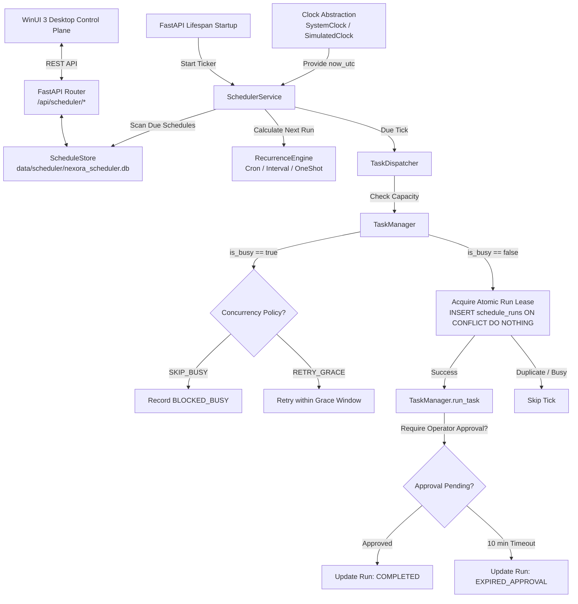

# NEXORA — Phase 13: Scheduler and Background Work Implementation Specification

## 1. Executive Summary

Phase 13 establishes an autonomous, dependable, and operator-governed background scheduling subsystem for NEXORA. Building upon the matured foundation of process launching, agent fleets, browser research, tool sandboxing, long-term memory, and desktop vision/interaction, Phase 13 introduces scheduled routines (recurring cron schedules, fixed periodic intervals, and one-shot delayed executions) while rigorously maintaining operator oversight, single-tenant concurrency safety, and system resilience.

The architecture is built upon the following strict core principles:
* **Operator Primacy & Dynamic Permissions:** Scheduled tasks run within the existing `TaskManager`, `PermissionManager`, and `AuditLogger` framework. No permanent prior approval bypass exists; sensitive capabilities (e.g. system commands, browser interactions, file mutations, desktop actions) dynamically re-evaluate risk and prompt the operator for fresh confirmation on every run.
* **Single-Tenant Capacity & Zero Collisions:** NEXORA operates with a single execution slot (`TaskManager._task_lock`). A schedule never overlaps with active tasks or another run of itself (`max_instances = 1`). Overlapping ticks fail closed cleanly as `BLOCKED_BUSY` or retry within a deterministic grace window (`RETRY_GRACE`).
* **Timezone & DST Awareness:** Recurrence calculations explicitly bind to IANA timezone names (e.g. `America/New_York`, `UTC`, `Europe/London`) using Python's standard `zoneinfo`. Wall-clock intention is preserved across Daylight Saving Time (DST) shifts without time creep or premature triggers.
* **Type-Aware Downtime Reconciliation:** Following a shutdown or crash, read-only summaries/digests trigger a single catchup execution (`RUN_ONCE_CATCHUP`), whereas mutating tasks skip missed intervals with an auditable alert (`SKIP_NOTIFY`). Runs interrupted mid-flight are marked `INTERRUPTED` and never replayed automatically.
* **Tamper & Drift Invalidation:** Modifying a prompt template or model profile automatically recalculates a SHA-256 `template_hash`. Any detected drift transitions the schedule to `PAUSED_INVALIDATED`, requiring explicit operator re-activation before execution.
* **Dedicated SQLite WAL Persistence:** Schedule definitions, atomic run leases, and historical execution records are isolated in `data/scheduler/nexora_scheduler.db`, ensuring crash resilience without polluting active agent task files.

---

## 2. Understanding Summary & Scope

### 2.1 What is Being Built
1. **Clock Abstraction Layer:** `Clock` interface with `SystemClock` for production and `SimulatedClock` for deterministic, sub-second unit and integration testing without wall-clock sleeps.
2. **Recurrence Engine:** Standard 5-field cron parser (`minute`, `hour`, `dom`, `month`, `dow`), human-friendly fixed interval parser (`every N<s|m|h|d>`), and one-shot ISO 8601 timestamp calculator, all timezone-aware via `zoneinfo`.
3. **Dedicated SQLite WAL Store:** Database manager and repository managing `schedules` and `schedule_runs` with atomic run leases, idempotency keys, and cascading cleanup.
4. **Task Dispatcher & Capacity Guard:** Bridges scheduled triggers into standard `AgentTask` objects, verifies `TaskManager.is_busy`, manages grace-window retries, and enforces the 10-minute approval timeout (`EXPIRED_APPROVAL`).
5. **Startup Reconciler & Drift Guard:** Scans missed runs across downtime, transitions abandoned active runs to `INTERRUPTED`, executes catchup or skip policies, and detects template/profile drift.
6. **Async Scheduler Ticker Service:** Native asyncio background loop integrated into the FastAPI lifespan, ticking at configurable intervals (default 1.0s in production, event-driven in testing).
7. **FastAPI Scheduler Router:** Full RESTful management API mounted at `/api/scheduler` for schedule CRUD, pause/resume, manual triggers, and run history.
8. **WinUI 3 Desktop Control Plane:** Navigation Item 7 ("Scheduler & Automation"), schedule card views, run history drawer, schedule creation/edit modal dialog, and ViewModel test suite.

### 2.2 Explicit Non-Goals
* No heavy external scheduler or message-queue dependencies (Celery, Redis, APScheduler, RabbitMQ).
* No Windows Task Scheduler dependency; NEXORA scheduler runs fully inside the portable backend runtime.
* No silent elevation or permanent pre-approval of sensitive agent permissions.
* No concurrent multi-task parallel execution; strictly respects single-tenant capacity limits.
* No cascading unbounded catches of multiple missed runs after prolonged offline periods.

---

## 3. Assumptions & Non-Functional Requirements

1. **Storage & Isolation:** Schedule database stored at `data/scheduler/nexora_scheduler.db` (configurable via `Settings.SCHEDULER_DATA_DIR`). Directory auto-created on startup.
2. **Deterministic CI Verification:** Unit tests must simulate days or years of recurrence, leap days, and DST transitions in under 1 second using `SimulatedClock`.
3. **Graceful Shutdown:** On backend shutdown (SIGINT/SIGTERM), the ticker terminates its loop and in-flight tasks finish or cleanly cancel within 5 seconds.
4. **Approval Timeout:** Any scheduled task requiring human operator confirmation aborts cleanly if not answered within 600 seconds (10 minutes), recording `EXPIRED_APPROVAL`.
5. **Performance Standards:**
   - Recurrence calculation: $\le 1\text{ ms}$
   - Atomic lease acquisition: $\le 5\text{ ms}$
   - Ticker cycle evaluation (up to 100 schedules): $\le 10\text{ ms}$
   - Zero regressions across existing 266 backend tests and 44 desktop tests.

---

## 4. Decision Log

* **D1:** Selected Native Asyncio Ticker with SQLite WAL state over external APScheduler or Windows Task Scheduler for zero external dependencies, lightweight lifecycle management, and full testing control.
* **D2:** Scheduled executions create standard `AgentTask` records, ensuring full parity with audit logs, permission gates, and execution state trees.
* **D3:** Dedicated SQLite database (`data/scheduler/nexora_scheduler.db`) in WAL mode isolates schedule definitions and run leases from active task JSON files.
* **D4:** All recurrence calculations use explicit IANA timezone strings via Python's standard `zoneinfo` module.
* **D5:** Injectable `Clock` abstraction (`SystemClock`, `SimulatedClock`) decouples all scheduling logic from physical system time, enabling instant time-travel unit testing.
* **D6:** Three trigger modalities supported: 5-field cron, fixed interval expressions (`every N<s|m|h|d>`), and one-shot ISO-8601 timestamps.
* **D7:** Atomic run lease key `run_key = f"{schedule_id}:{scheduled_iso}"` with unique SQLite constraint prevents duplicate executions across restarts or overlapping ticks.
* **D8:** Single-tenant capacity guard: when `TaskManager` is busy, schedules either drop execution as `BLOCKED_BUSY` (`SKIP_BUSY`) or retry within a configurable grace window (`RETRY_GRACE`).
* **D9:** Type-aware downtime recovery: read-only schedules catch up once (`RUN_ONCE_CATCHUP`); mutating schedules skip missed runs with an audit notification (`SKIP_NOTIFY`). Interrupted runs are never automatically replayed.
* **D10:** Unanswered approval requests expire after 10 minutes (600s), setting run status to `EXPIRED_APPROVAL`.
* **D11:** Prompt template or model profile modification recomputes SHA-256 `template_hash`. Any mismatch pauses the schedule as `PAUSED_INVALIDATED` until operator re-activation.
* **D12:** WinUI 3 desktop client adds a 7th navigation view ("Scheduler & Automation") with cards, status indicators, creation dialog, and run history.

---

## 5. Architectural Design & Component Specifications

### 5.1 Architecture Diagram



---

### 5.2 Domain Models (`backend/app/scheduler/models.py`)

```python
from enum import Enum
from typing import Optional
from datetime import datetime
from pydantic import BaseModel, Field

class TriggerType(str, Enum):
    CRON = "CRON"
    INTERVAL = "INTERVAL"
    ONE_SHOT = "ONE_SHOT"

class ScheduleStatus(str, Enum):
    ACTIVE = "ACTIVE"
    PAUSED = "PAUSED"
    PAUSED_INVALIDATED = "PAUSED_INVALIDATED"
    COMPLETED = "COMPLETED"

class MissedRunPolicy(str, Enum):
    SKIP_NOTIFY = "SKIP_NOTIFY"
    RUN_ONCE_CATCHUP = "RUN_ONCE_CATCHUP"

class ConcurrencyPolicy(str, Enum):
    SKIP_BUSY = "SKIP_BUSY"
    RETRY_GRACE = "RETRY_GRACE"

class RunStatus(str, Enum):
    DISPATCHED = "DISPATCHED"
    COMPLETED = "COMPLETED"
    FAILED = "FAILED"
    SKIPPED = "SKIPPED"
    BLOCKED_BUSY = "BLOCKED_BUSY"
    EXPIRED_APPROVAL = "EXPIRED_APPROVAL"
    INTERRUPTED = "INTERRUPTED"

class ScheduleCreate(BaseModel):
    name: str
    prompt_template: str
    model_profile_id: Optional[str] = None
    trigger_type: TriggerType
    trigger_expression: str
    timezone: str = "UTC"
    missed_run_policy: MissedRunPolicy = MissedRunPolicy.SKIP_NOTIFY
    concurrency_policy: ConcurrencyPolicy = ConcurrencyPolicy.SKIP_BUSY
    max_instances: int = 1
    retry_grace_seconds: int = 300

class ScheduleUpdate(BaseModel):
    name: Optional[str] = None
    prompt_template: Optional[str] = None
    model_profile_id: Optional[str] = None
    trigger_type: Optional[TriggerType] = None
    trigger_expression: Optional[str] = None
    timezone: Optional[str] = None
    missed_run_policy: Optional[MissedRunPolicy] = None
    concurrency_policy: Optional[ConcurrencyPolicy] = None
    retry_grace_seconds: Optional[int] = None

class Schedule(BaseModel):
    id: str
    name: str
    prompt_template: str
    model_profile_id: Optional[str]
    trigger_type: TriggerType
    trigger_expression: str
    timezone: str
    status: ScheduleStatus
    missed_run_policy: MissedRunPolicy
    concurrency_policy: ConcurrencyPolicy
    max_instances: int
    retry_grace_seconds: int
    next_run_at: Optional[datetime]
    last_run_at: Optional[datetime]
    template_hash: str
    created_at: datetime
    updated_at: datetime

class ScheduleRun(BaseModel):
    run_id: str
    schedule_id: str
    task_id: Optional[str]
    run_key: str
    status: RunStatus
    scheduled_for: datetime
    dispatched_at: datetime
    finished_at: Optional[datetime]
    error_message: Optional[str]
```

---

### 5.3 Clock Abstraction (`backend/app/scheduler/clock.py`)

```python
from abc import ABC, abstractmethod
from datetime import datetime, timezone, timedelta

class Clock(ABC):
    @abstractmethod
    def now_utc(self) -> datetime:
        pass

class SystemClock(Clock):
    def now_utc(self) -> datetime:
        return datetime.now(timezone.utc)

class SimulatedClock(Clock):
    def __init__(self, initial_time: datetime):
        if initial_time.tzinfo is None:
            initial_time = initial_time.replace(tzinfo=timezone.utc)
        self._current_time: datetime = initial_time

    def now_utc(self) -> datetime:
        return self._current_time

    def advance(self, delta: timedelta) -> datetime:
        self._current_time += delta
        return self._current_time

    def set_time(self, new_time: datetime) -> datetime:
        if new_time.tzinfo is None:
            new_time = new_time.replace(tzinfo=timezone.utc)
        self._current_time = new_time
        return self._current_time
```

---

### 5.4 Recurrence Engine (`backend/app/scheduler/recurrence.py`)

The recurrence engine calculates future execution timestamps based on current clock time and IANA timezone:
1. **Cron Expression:** Standard 5 fields (`minute hour dom month dow`). Parsed using standard field matching and calendar date construction via Python `zoneinfo.ZoneInfo`. Evaluates candidate times in local timezone and converts to UTC.
2. **Fixed Interval:** Parsed via regex `r"^(\d+)\s*([smhd])$"`. Next run is strictly `reference_utc + timedelta(seconds=...)`.
3. **One-Shot:** Parsed as ISO 8601 string. If timestamp is in the future, `next_run_at` is that timestamp; if past, `None`. Once executed, schedule status transitions to `COMPLETED`.
4. **DST Preservation:** Local wall-clock times (e.g. 09:00 AM) are calculated in the local timezone, preventing clock skew when DST begins or ends.

---

### 5.5 Storage & SQLite Schema (`backend/app/scheduler/store.py`)

Database resides at `data/scheduler/nexora_scheduler.db`.
Initialization pragmas:
```sql
PRAGMA journal_mode = WAL;
PRAGMA synchronous = NORMAL;
PRAGMA busy_timeout = 5000;
PRAGMA foreign_keys = ON;
```

Tables:
```sql
CREATE TABLE IF NOT EXISTS schedules (
    id TEXT PRIMARY KEY,
    name TEXT NOT NULL,
    prompt_template TEXT NOT NULL,
    model_profile_id TEXT,
    trigger_type TEXT NOT NULL,
    trigger_expression TEXT NOT NULL,
    timezone TEXT NOT NULL,
    status TEXT NOT NULL,
    missed_run_policy TEXT NOT NULL,
    concurrency_policy TEXT NOT NULL,
    max_instances INTEGER NOT NULL DEFAULT 1,
    retry_grace_seconds INTEGER NOT NULL DEFAULT 300,
    next_run_at TEXT,
    last_run_at TEXT,
    template_hash TEXT NOT NULL,
    created_at TEXT NOT NULL,
    updated_at TEXT NOT NULL
);

CREATE TABLE IF NOT EXISTS schedule_runs (
    run_id TEXT PRIMARY KEY,
    schedule_id TEXT NOT NULL,
    task_id TEXT,
    run_key TEXT UNIQUE NOT NULL,
    status TEXT NOT NULL,
    scheduled_for TEXT NOT NULL,
    dispatched_at TEXT NOT NULL,
    finished_at TEXT,
    error_message TEXT,
    FOREIGN KEY(schedule_id) REFERENCES schedules(id) ON DELETE CASCADE
);

CREATE INDEX IF NOT EXISTS idx_schedules_next_run ON schedules(next_run_at) WHERE status = 'ACTIVE';
CREATE INDEX IF NOT EXISTS idx_schedule_runs_schedule_id ON schedule_runs(schedule_id);
CREATE INDEX IF NOT EXISTS idx_schedule_runs_status ON schedule_runs(status);
```

---

### 5.6 Task Dispatcher & Capacity Guard (`backend/app/scheduler/dispatcher.py`)

* Coordinates between `ScheduleStore` and `TaskManager`.
* Validates `template_hash` against the current prompt and model profile.
* Performs atomic lease reservation in `schedule_runs` with `run_key`.
* Evaluates `TaskManager.is_busy`:
  - If idle, dispatches execution as `AgentTask` via `TaskManager.run_task(prompt=..., model_profile=...)`.
  - If busy, branches by `concurrency_policy`:
    - `SKIP_BUSY`: marks run as `BLOCKED_BUSY` immediately and advances `next_run_at`.
    - `RETRY_GRACE`: queues a retry check within `retry_grace_seconds`. If grace expires without capacity, records `BLOCKED_BUSY`.
* Monitors pending approvals: if task stays in `WAITING_APPROVAL` for $> 600\text{ s}$, dispatches cancellation and marks `EXPIRED_APPROVAL`.

---

### 5.7 Startup Reconciler (`backend/app/scheduler/reconciler.py`)

* Executed immediately during FastAPI lifespan startup before starting the ticker:
  1. Identifies any `schedule_runs` with status `DISPATCHED` from an interrupted process and updates them to `INTERRUPTED` with `finished_at = now`.
  2. Queries `schedules` where `status = 'ACTIVE'` and `next_run_at <= now`.
  3. For each overdue schedule:
     - If `missed_run_policy == RUN_ONCE_CATCHUP`: schedules an immediate one-time execution and updates `next_run_at` to the subsequent scheduled period.
     - If `missed_run_policy == SKIP_NOTIFY`: records a `SKIPPED` run entry in `schedule_runs`, emits an audit log notification, and advances `next_run_at` to the next future period.

---

### 5.8 FastAPI REST API (`backend/app/api/scheduler.py`)

Mounted at `/api/scheduler`:
* `GET /schedules`: List all schedules.
* `POST /schedules`: Create schedule with validation.
* `GET /schedules/{schedule_id}`: Get schedule details.
* `PATCH /schedules/{schedule_id}`: Edit schedule fields.
* `POST /schedules/{schedule_id}/pause`: Pause an active schedule.
* `POST /schedules/{schedule_id}/resume`: Resume a paused schedule.
* `DELETE /schedules/{schedule_id}`: Delete schedule and its runs.
* `POST /schedules/{schedule_id}/trigger`: Trigger manual immediate run.
* `GET /runs`: List recent runs (query parameters: `schedule_id`, `status`, `limit`).

---

### 5.9 WinUI 3 Desktop Control Plane (`DesktopUI`)

1. **Navigation Integration:**
   - Adds 7th navigation item: "Scheduler & Automation" with Clock glyph.
2. **Scheduler View (`DesktopUI/Views/SchedulerView.xaml`):**
   - Active schedules list with name, prompt preview, next run countdown, trigger expression, and status badge.
   - Action buttons: "Run Now", "Pause" / "Resume", "Edit", "Delete", and "New Schedule".
   - Create / Edit Schedule Dialog: Form for Cron / Interval / One-shot expressions, timezone picker, prompt template, model profile selector, and policies.
   - Execution History Drawer: Historical runs table with badges (`COMPLETED`, `FAILED`, `BLOCKED_BUSY`, `EXPIRED_APPROVAL`, `SKIPPED`, `INTERRUPTED`).
3. **C# ViewModels & Services:**
   - `SchedulerViewModel.cs` implementing reactive commands, loading states, and error handling.
   - `INexoraApiClient.cs` extended with scheduler endpoints, implemented in `NexoraApiClient.cs`.
   - Unit tests in `DesktopUI.Tests/SchedulerViewModelTests.cs`.

---

## 6. Verification & Testing Strategy

1. **Clock & Recurrence Tests:**
   - 5-field cron parsing (every minute, hourly, daily, weekdays, monthly, leap day Feb 29).
   - Interval parsing (`30s`, `15m`, `2h`, `1d`).
   - Timezone resilience & DST transitions (`America/New_York` spring forward and fall back).
   - Instant time advancement using `SimulatedClock` without real wall-clock sleeps.
2. **Store & Idempotency Tests:**
   - SQLite table creation in WAL mode.
   - CRUD operations for schedules and runs.
   - Unique `run_key` lease acquisition preventing duplicate dispatch.
3. **Dispatcher & Policy Tests:**
   - Busy task runner handling with `SKIP_BUSY` vs `RETRY_GRACE`.
   - Approval expiration after 10-minute timeout (`EXPIRED_APPROVAL`).
   - Drift detection causing `PAUSED_INVALIDATED`.
4. **Startup Reconciliation Tests:**
   - `RUN_ONCE_CATCHUP` vs `SKIP_NOTIFY` on missed runs.
   - Recovery of orphaned `DISPATCHED` runs into `INTERRUPTED`.
5. **API & End-to-End Tests:**
   - FastAPI test client verification of all `/api/scheduler/*` endpoints.
   - Full regression pass of all existing 266 backend tests.
6. **WinUI 3 Desktop Tests:**
   - ViewModel state transitions, API mock dispatch, error handling.
   - Full regression pass of all existing 44 desktop tests.
