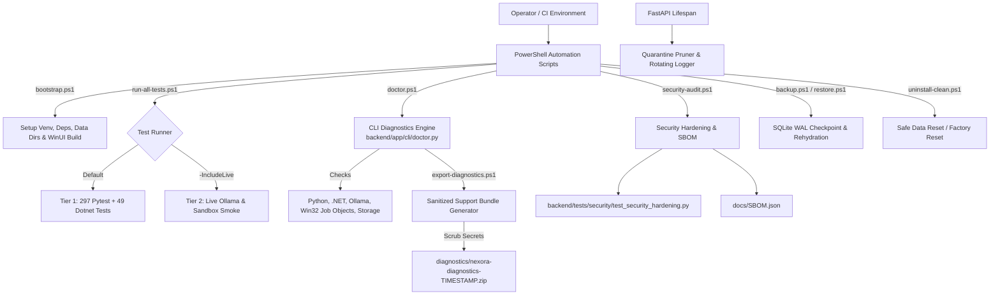

# NEXORA — Phase 14: Hardening and Release Implementation Specification

## 1. Executive Summary

Phase 14 represents the final, unifying phase of NEXORA v1.0. It integrates, hardens, verifies, and packages the complete autonomous agent platform across all previous phases (Phases 0 through 13). Rather than introducing speculative or unreviewed capabilities, Phase 14 establishes deterministic reproducibility, rigorous observable diagnostics, robust disaster recovery, and an honest validation matrix for a real-world Windows laptop.

The core tenets of Phase 14 include:
* **Hermetic Offline Gating with Tiered Live Smoke:** The default validation run executes all 297 backend tests and 49 desktop tests completely offline in $\le 60\text{ s}$ without external dependencies. Live local validation against Ollama and real sandboxed processes is opt-in via explicit flags and never conflated with mock tests.
* **Pre-Flight Diagnostics & Redacted Support:** A dedicated system doctor (`scripts/doctor.ps1` and `backend/app/cli/doctor.py`) introspects host capabilities (Python 3.14+, .NET 8, Ollama, Win32 Job Objects, UI Automation, SQLite WAL) and exports sanitized diagnostic archives with zero secret or prompt leakage.
* **Adversarial Security Hardening:** Comprehensive adversarial regression tests verify fail-closed protections against prompt injection, disallowed system commands, path traversal, and blacklisted credential manager windows.
* **Full Data Lifecycle & Disaster Recovery:** Native online WAL checkpointing scripts (`scripts/backup.ps1` and `scripts/restore.ps1`), 10MB rotating log handlers, 24-hour quarantine pruning, and an interactive factory reset utility (`scripts/uninstall-clean.ps1`).
* **Transparent Documentation Suite:** Complete release documentation covering deployment, testing matrices, security audits, recovery procedures, and release notes.

---

## 2. Understanding Summary & Scope

### 2.1 What is Being Built
1. **Tiered Test Runner Script (`scripts/run-all-tests.ps1`):** Orchestrates offline pytest and dotnet tests by default, with an optional `-IncludeLive` flag for local Ollama smoke verification.
2. **Environment Diagnostics & Doctor (`backend/app/cli/doctor.py` & `scripts/doctor.ps1`):** Evaluates environment readiness across 5 core verification gates.
3. **Sanitized Support Bundle Exporter (`scripts/export-diagnostics.ps1`):** Packages system specs, component status, and sanitized logs into `diagnostics/nexora-diagnostics-<timestamp>.zip` with regex-based secret scrubbing.
4. **Adversarial Security Test Suite (`backend/tests/security/test_security_hardening.py`):** Automated tests for prompt injection defense, command whitelisting, shielded process protection, path traversal blocks, and localhost loopback binding.
5. **Security Audit & SBOM Tool (`scripts/security-audit.ps1`):** Generates `docs/SBOM.json` and runs dependency vulnerability scans.
6. **Data Lifecycle Automation:**
   - `scripts/backup.ps1`: SQLite WAL checkpoints, profile archives, and SHA-256 checksums.
   - `scripts/restore.ps1`: Integrity validation and clean rehydration.
   - `scripts/uninstall-clean.ps1`: Selective data pruning or full factory reset.
7. **Rotating Log & Quarantine Pruning:** Configures `RotatingFileHandler` (10MB limit, 5 backups) and automatic 24-hour quarantine file cleanup during backend lifespan.
8. **Onboarding Bootstrap Script (`scripts/bootstrap.ps1`):** Single-command setup for Python venv, dependencies, data directories, and desktop compilation.
9. **Documentation Suite:** `README.md`, `docs/DEPLOYMENT_GUIDE.md`, `docs/TEST_MATRIX.md`, `docs/SECURITY_AUDIT.md`, `docs/BACKUP_RECOVERY.md`, and `RELEASE_NOTES.md`.

### 2.2 Explicit Non-Goals
* No new unreviewed features or tools added under the guise of release.
* No conflating mock tests with live hardware verification.
* No weakening of permissions, sandbox boundaries, or human approvals to bypass tests.
* No public network listening (backend is strictly bound to `127.0.0.1`).

---

## 3. Assumptions & Non-Functional Requirements

1. **Host Environment:** Windows 10/11 x64 laptop with Python 3.14+, .NET 8 SDK, and optional local Ollama (`qwen2.5:7b` / `llama3.2`).
2. **Performance Standard:** Default offline test suite execution time $\le 60\text{ s}$.
3. **Log & Storage Bounds:** Max 10MB per log file with 5 rotated generations; quarantine evidence auto-pruned past 24 hours.
4. **Localhost Isolation:** Backend strictly binds to `127.0.0.1:8000` with local CORS (`localhost:3000`, `127.0.0.1:3000`, etc.).
5. **Zero Regressions:** All 297 existing backend tests and 49 desktop unit tests must remain 100% passing.

---

## 4. Decision Log

* **D1:** Adopted **Approach 1: Native Windows Scripting & Python Hardening Suite** using native PowerShell scripts and standard Python modules over heavy third-party CLI frameworks.
* **D2:** Strict separation between hermetic offline tests (Tier 1 default) and opt-in live smoke tests (Tier 2 via `-IncludeLive`).
* **D3:** Diagnostic export bundles must pass through the Phase 11 `SecretScrubber` regex engine, strictly redacting all tokens, passwords, and user prompts.
* **D4:** Online SQLite database backups perform atomic `PRAGMA wal_checkpoint(TRUNCATE)` before archiving.
* **D5:** Logging converted from standard file writing to `RotatingFileHandler` (10MB max, 5 backups).
* **D6:** Quarantine directory automatically prunes files older than 24 hours during backend startup and shutdown.
* **D7:** Backend enforces exclusive loopback binding (`127.0.0.1`) and rejects remote origins.
* **D8:** Documentation suite organized in `docs/` with explicit capability classifications (*Mocked*, *Fixture*, *Live*, *Unsupported*).

---

## 5. Architectural Design & Component Specifications

### 5.1 Architecture Diagram

---

### 5.2 Diagnostics Engine (`backend/app/cli/doctor.py`)

A modular Python diagnostic tool that can be invoked via `python -m backend.app.cli.doctor` or PowerShell wrapper `scripts/doctor.ps1`:
* **Checks:**
  1. `check_python_environment()`: Validates Python version $\ge 3.14$, checks installed packages against `requirements.txt`.
  2. `check_dotnet_environment()`: Locates `dotnet.exe`, validates .NET 8 SDK availability.
  3. `check_ollama_service()`: Pings `http://localhost:11434/api/tags`, checks configured models.
  4. `check_windows_capabilities()`: Validates Win32 Job Object creation (`ctypes.windll.kernel32.CreateJobObjectW`), UI Automation availability.
  5. `check_storage_and_wal()`: Validates read/write/WAL capabilities in `data/memory`, `data/scheduler`, `data/tasks`, `data/logs`.
* **Export Mode (`--export`):**
  - Collects system hardware/OS information, diagnostics report, recent 500 log lines, and sanitized configuration.
  - Passes all content through `SecretScrubber`.
  - Packages into `diagnostics/nexora-diagnostics-<timestamp>.zip`.

---

### 5.3 Adversarial Security Regression Suite (`backend/tests/security/test_security_hardening.py`)

* Tests:
  1. `test_prompt_injection_safety()`: Simulates adversarial prompts trying to override system instructions or invoke unauthorized tools.
  2. `test_terminal_command_whitelist_enforcement()`: Tests execution of disallowed commands (`cmd.exe`, `powershell -enc`, `format`, `reg`).
  3. `test_filesystem_path_traversal_blocked()`: Tests read/write operations with `..`, `C:\Windows\System32`, and sensitive paths.
  4. `test_shielded_desktop_windows_fail_closed()`: Asserts credential managers (`1password.exe`, `bitwarden.exe`, `keepass.exe`, `credentialuibroker.exe`) are blocked as `UNCERTAIN`.
  5. `test_secret_scrubber_in_logs_and_traces()`: Asserts tokens, passwords, and private keys are never stored in plaintext.
  6. `test_backend_localhost_binding_and_cors()`: Asserts backend server binds strictly to `127.0.0.1` and CORS blocks external origins.

---

### 5.4 Data Lifecycle & Maintenance Scripts

1. **`scripts/backup.ps1`:**
   - Truncates SQLite WAL files via `PRAGMA wal_checkpoint(TRUNCATE)`.
   - Packages `data/memory/nexora_memory.db`, `data/scheduler/nexora_scheduler.db`, `data/skills/`, `data/mcp/`, `model_profiles.json` into `data/backups/nexora-backup-<timestamp>.zip`.
   - Generates SHA-256 checksum manifest.
2. **`scripts/restore.ps1`:**
   - Validates SHA-256 manifest.
   - Extracts files and executes `PRAGMA integrity_check` on restored SQLite databases.
3. **`scripts/uninstall-clean.ps1`:**
   - Cleans temporary logs, task traces, sandbox runs, or executes full factory reset.
4. **Log Rotation & Pruning in Backend Lifespan:**
   - Updates `backend/app/core/logging.py` to use `RotatingFileHandler(maxBytes=10*1024*1024, backupCount=5)`.
   - Implements `backend/app/core/pruner.py` which runs during startup and shutdown to remove quarantine files older than 24 hours.

---

### 5.5 Release Packaging & Documentation Suite

* `scripts/bootstrap.ps1`: One-click setup for local environment.
* `scripts/run-all-tests.ps1`: Tiered test runner with `-Offline` and `-IncludeLive` options.
* `scripts/security-audit.ps1`: Generates `docs/SBOM.json` and runs security checks.
* `README.md`: Master project documentation and quickstart.
* `docs/DEPLOYMENT_GUIDE.md`: Clean checkout to running app on Windows.
* `docs/TEST_MATRIX.md`: Complete matrix across Phases 0–14.
* `docs/SECURITY_AUDIT.md`: Threat model, defenses, and trust boundaries.
* `docs/BACKUP_RECOVERY.md`: Backup, restore, log rotation, and factory reset guide.
* `RELEASE_NOTES.md`: Official v1.0.0 release notes with supported hardware matrix.

---

## 6. Verification & Acceptance Criteria

1. All 297 existing backend tests pass offline in $\le 60\text{ s}$.
2. All 49 existing desktop unit tests pass via `dotnet test`.
3. WinUI 3 Desktop solution compiles with 0 errors and 0 warnings.
4. All new Phase 14 adversarial security tests pass.
5. `scripts/doctor.ps1` executes all 5 checks successfully.
6. `scripts/export-diagnostics.ps1` exports a redacted ZIP archive with 0 leaked secrets.
7. `scripts/backup.ps1` and `scripts/restore.ps1` successfully backup, verify, and restore SQLite databases.
8. `scripts/bootstrap.ps1` dry-run passes on clean environment.
9. Documentation files are complete, cross-linked, and validated.
