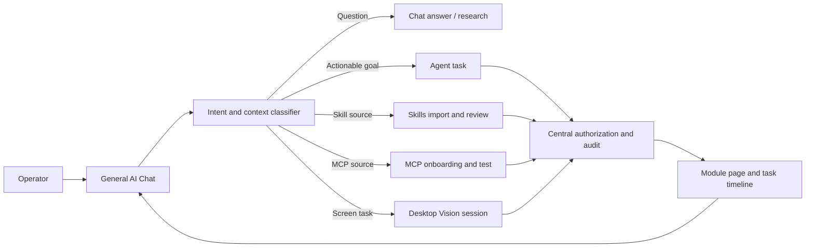
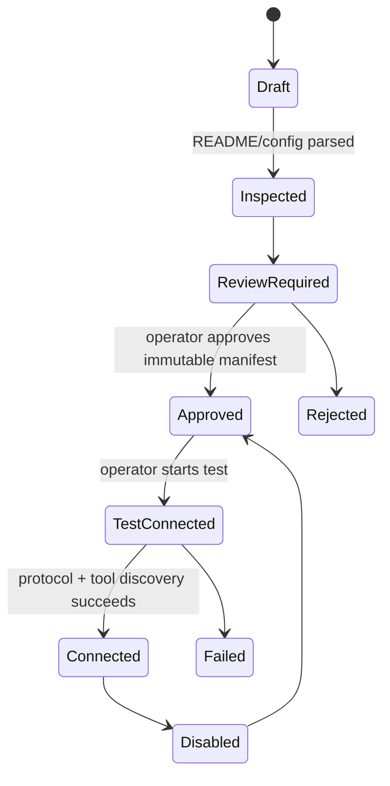

# NEXORA Phase 15 — Chat-First Experience and Autonomous Desktop Specification

## Status

**Planning only — no implementation is implied by this document.**

Phase 15 is the NEXORA 1.2 product update. It changes the desktop experience from a collection of separate operational pages into a chat-first control plane: the operator starts in one general AI conversation, and NEXORA routes the resulting work into Tasks, Skills, MCP, Research, Scheduler, Memory, and Desktop Vision without losing traceability or authorization.

Existing Phase 0–14 implementation remains the foundation. This phase must not replace the FastAPI backend, WinUI 3 desktop application, local-model routing, approvals, audit trail, MCP registry, sandbox, memory store, scheduler, or desktop focus guard.

## 1. Product Outcome

The landing experience is a general-purpose local AI chat. A user can ask an ordinary question, request research, ask NEXORA to perform a task, install a skill, connect an MCP server, or ask for desktop assistance in the same conversation.

The assistant responds conversationally first, then shows a clear work card when it proposes an action. A work card identifies what NEXORA understood, the destination module, the selected model/profile, required permissions, status, and a link to the detailed page. Every module can also send its results back into the originating chat as cited, structured messages.



## 2. Experience Requirements

### 2.1 Chat is the landing screen

1. Launching the WinUI app opens **Chat**, not the historical task list.
2. The chat supports multi-turn local conversations, streaming status, copy, retry, and cancellation.
3. The composer accepts normal prose plus optional attachments/links only when supported by the local backend.
4. Each message has an immutable conversation ID, message ID, timestamp, model/profile reference, and source references.
5. The chat must work for non-task questions. It must not create an agent task merely because the user asked a simple question.
6. The user may explicitly choose **Answer only**, **Create task**, **Research**, **Use Desktop Vision**, or **Auto route**. Auto route is the provisional default.
7. A model/profile selector remains visible as a manual override. Automatic hybrid routing remains the default.

### 2.2 Chat-to-module handoff

The backend creates a `ConversationWorkItem` whenever a chat turn results in operational work. It contains:

| Field | Purpose |
|---|---|
| `work_item_id` | Stable link between a chat message and a module record. |
| `conversation_id`, `source_message_id` | Traceability back to the operator request. |
| `intent` | `answer`, `task`, `research`, `skill_import`, `mcp_onboard`, `desktop_vision`, or `schedule`. |
| `target_module` | Destination module/page. |
| `target_id` | Created task, import candidate, MCP server, desktop session, or schedule ID. |
| `status` | Draft, awaiting confirmation, running, waiting approval, complete, failed, cancelled. |
| `summary` | Plain-language explanation shown in the work card. |
| `routing` | Selected profile/model, reason, escalation state. |
| `authorization_state` | None, confirmation needed, approval pending, approved, rejected, expired. |
| `evidence_refs` | Audit, source, screenshot, sandbox, or research identifiers. |

Handoff rules:

1. **Answer**: reply in chat; do not create work unless the user asks to continue.
2. **Task**: create a normal Phase 2 agent task and open an inline task card. The Tasks page shows the same record.
3. **Research**: create a research-backed task only if the request needs multi-step action; otherwise return cited research in chat.
4. **Skill import**: create an import candidate in a non-executing review state.
5. **MCP onboarding**: create an unapproved server candidate. Connection and tool discovery occur only after clear operator approval.
6. **Desktop Vision**: create a bounded desktop session tied to the originating task and desktop authorization policy.
7. **Schedule**: create a schedule draft; activating it requires the existing explicit review/approval path.

### 2.3 Cross-page synchronization

The Chat page is the entry point; it is not a duplicate system. Module pages remain the detailed operating surfaces.

- Selecting a work card navigates to its module and preserves the selected record.
- A module completion, failure, cancellation, or approval request posts a concise event into the originating chat.
- A module page can use **Send to chat** to add an operator-visible summary without exposing raw secrets, unreviewed tool output, or quarantined file contents.
- UI state comes from the backend record IDs, not duplicated client-only state.
- Refreshing or restarting the desktop app restores the conversation/work-item relationship from durable local storage.

## 3. Skills Import and Discovery

### 3.1 Operator entry points

The Skills page and chat must offer three clear methods:

1. **Import folder**: select a local folder containing `manifest.json` and `SKILL.md`.
2. **Open local skills folder**: open the configured local skills directory in Explorer so the operator can paste a prepared skill folder. The page then offers refresh/scan.
3. **Paste definition**: paste a manifest and Markdown instructions into an import draft.

GitHub discovery remains available but is read-only until import is chosen.

### 3.2 Staged import lifecycle

```text
Discovered / selected → Parsed → Validated → Review required → Installed disabled → Enabled → Injected selectively
```

- Import never executes Markdown, code, scripts, or setup commands.
- Imported skills default to **disabled** until the operator reviews provenance, hash, manifest, permissions, and target roles.
- A skill is injected only for compatible roles/tasks and only after it is enabled.
- Folder scan must treat each folder as untrusted input. It cannot follow directory traversal outside the selected folder.
- Re-importing an existing ID/version must show a deterministic conflict decision: keep, replace after review, or install as a new version. No silent overwrite.

### 3.3 GitHub preview requirements

The GitHub candidate preview screen must display:

1. Repository name, owner, default branch, URL, stars, and selected path.
2. `README.md` rendered as sanitized Markdown, or an explicit “README not found” state.
3. `manifest.json` and `SKILL.md` previews in separate tabs/panes.
4. Commit SHA or immutable ref when available; a branch name alone is not sufficient provenance for a final install.
5. Files actually fetched and their hashes.
6. A warning that repository README content is untrusted documentation, not system instructions.

README rendering must not execute HTML, JavaScript, external embeds, or commands. Links must require an explicit operator click.

## 4. MCP Onboarding and Testing

### 4.1 Supported ways to create a candidate

1. **Manual setup**: operator enters executable, arguments, optional working directory, and vault references.
2. **Repository-assisted setup**: operator supplies an MCP repository URL. NEXORA inspects README/configuration files and proposes a launch manifest; it must never install packages or launch the server just from a URL.
3. **Chat-assisted setup**: the user asks the chat to connect an MCP server. Chat produces the same reviewable candidate, never a bypass around MCP approval.

### 4.2 Candidate lifecycle



Required review facts: command, exact tokenized arguments, working directory, environment keys (never secret values), package-install command if any, source URL/ref, advertised tools, and requested capabilities.

### 4.3 Test connection

After approval, **Test connection** may launch the server through the existing stdio transport in a bounded test session. It performs only:

1. process launch;
2. MCP initialize handshake;
3. `tools/list` discovery;
4. optional ping;
5. clean shutdown.

It must not invoke discovered tools automatically. A user may select one non-mutating test tool after a second confirmation. All discovered tools are initially **Sensitive** until individually classified/reviewed. An approved server manifest is not blanket approval for arbitrary tool actions.

## 5. Autonomous Desktop Vision

### 5.1 Goal

Desktop Vision may execute an approved task end-to-end: capture the screen, inspect accessible UI elements, identify the target, perform permitted interactions, verify postconditions, and return evidence to the task and chat.

“Autonomous” means the agent performs the permitted loop without asking for a confirmation before every safe click. It does **not** mean unrestricted control of the desktop.

### 5.2 Operating contract

1. Desktop automation starts only from an explicit chat/task intent or a manual **Start Desktop Session** action.
2. Before first interaction, the work card shows target application/window, intended goal, interaction scope, and screen-capture policy.
3. A session has a task ID, target-window identity, allowed interaction categories, time limit, action budget, and emergency-stop token.
4. Screen capture is on-demand by default. Continuous capture must be a visible, separately enabled session option.
5. NEXORA may autonomously capture and inspect only while its session is active and its target remains allowed by `WindowFocusGuard`.
6. Any focus change to a different application pauses the session and requires an explicit resume. A protected window, UAC prompt, password field, browser payment page, or uncertain target fails closed.
7. Text entry, file chooser actions, clipboard access, downloads, login flows, external submission, destructive UI actions, and security-setting changes are Sensitive and use the central approval service.
8. The user can stop a session through chat, the companion, the task page, or an emergency keyboard shortcut. Stop must revoke pending queued interactions.
9. Screenshots and UI-tree snapshots are quarantined, redacted where feasible, retained by policy, and recorded as evidence references—not injected wholesale into prompts.

### 5.3 Autonomous loop

```text
Acquire approved session
→ capture permitted target
→ inspect UI tree / vision evidence
→ choose next allowed action
→ revalidate target + focus + policy
→ authorize action
→ execute one interaction
→ capture/inspect verification evidence
→ repeat within budgets
→ complete, pause for approval, or fail closed
```

The loop must have deterministic exit conditions: completed goal, action budget exceeded, session timeout, target lost, protected content detected, confidence below threshold, repeated verification failure, operator stop, or expired authorization.

### 5.4 Provisional defaults

These choices remain provisional and must be presented in Settings:

| Setting | Provisional default |
|---|---|
| Session duration | 10 minutes |
| Safe interaction budget | 30 actions |
| Screenshot mode | On demand; every action only when verification requires it |
| Existing browser sessions | Isolated browser by default; existing session only after explicit authorization |
| Cross-window control | Disabled; pause on focus/window change |
| Protected targets | Always blocked |
| Sensitive interaction | Central per-action approval |
| Evidence retention | Existing quarantine/retention policy |

## 6. Architecture and Data Boundaries

### 6.1 New backend components

- `conversation/`: durable conversations, messages, work-item records, intent routing, and event bridge.
- `skills/importer/`: folder validation, staged import, Explorer launch command broker, and GitHub README retrieval.
- `mcp/onboarding/`: repository inspection, manifest proposal, immutable approval fingerprint, test-session coordinator.
- `desktop/autonomy/`: session budgets, loop controller, action verifier, evidence policy, stop/revocation coordinator.

### 6.2 New desktop components

- `ChatView`, `ChatViewModel`, conversation list, composer, work cards, streaming state.
- `SkillImportDialog` and `GitHubPreviewView` with README/manifest/skill tabs.
- `McpOnboardingWizard` with manual/repository/chat origin, review, test, and discovered-tool classification screens.
- `DesktopSessionPanel` in the task and companion surfaces: active target, capture indicator, policy, action count, pause/resume, stop.

### 6.3 Central services that must remain authoritative

- `PermissionManager`: all sensitive or unknown actions.
- Tool registry: only registered, classified capabilities can execute.
- Audit/evidence stores: action request, decision, execution, result, and verification.
- `WindowFocusGuard`: target and protected-window decisions.
- MCP registry/session pool: approval, process lifecycle, and tool registration.
- Sandbox service: generated tool validation and real sandbox execution.

## 7. Non-Goals

- No cloud account requirement or remote model dependency.
- No direct execution of GitHub README, SKILL.md, MCP repository content, or install scripts.
- No password-manager, UAC, banking/payment, credential, or security-settings automation.
- No unbounded background screen recording or cross-application UI control.
- No replacement of dedicated module pages with chat-only UI.
- No assertion that a third-party MCP repository is safe merely because it has a README.

## 8. Acceptance Criteria

1. Chat is the default launch view and supports normal answer-only conversations.
2. An auto-routed actionable prompt creates one linked work item and one destination record, visible in both chat and the module page.
3. A task completion/approval/failure event returns to the originating conversation.
4. Local skill folder import, Explorer-folder opening, and paste import create disabled review candidates; none execute content.
5. GitHub preview displays a sanitized README and exact skill artifacts before installation.
6. Manual, repository-assisted, and chat-assisted MCP onboarding all converge on the same immutable approval and test lifecycle.
7. MCP test connection does not execute a discovered tool without additional operator approval.
8. Desktop Vision can perform a safe, single-window task autonomously within its active session budget and produce verification evidence.
9. Desktop Vision pauses/fails closed on protected windows, focus changes, target ambiguity, timeout, or emergency stop.
10. Existing Phase 0–14 behavior, task history, routing diagnostics, audit evidence, and manual model override remain functional.
