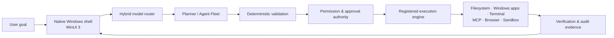

# NEXORA

> **A local-first autonomous intelligence system for Windows**
> *Models propose. Deterministic software validates, authorizes, executes, and verifies.*

```text
╔══════════════════════════════════════════════════════════════════════╗
║  NEXORA                                                             ║
║  Native Windows control plane · Local models · Governed execution   ║
╚══════════════════════════════════════════════════════════════════════╝
```

NEXORA is a Windows-native AI agent platform designed to turn natural-language goals into controlled, verifiable local actions. It uses locally hosted models through Ollama for reasoning and planning, while a deterministic Python engine retains authority over validation, permissions, execution, retries, auditing, and result verification.

The project is moving toward a **C#/.NET WinUI 3 native Windows shell** with a full dashboard and an optional always-on-top corner companion. The current repository already contains the local Python/FastAPI engine that the native shell will control.

## What NEXORA is building



NEXORA is not an unrestricted model with access to the computer. It follows one core rule:

> **A model can request an action. It cannot perform the action directly.**

Every external effect must pass through typed validation, a central permission policy, an approval decision when needed, a registered executor, and a post-action verification step.

---

## Current implementation status

| Area | Status | What exists |
|---|---|---|
| Core backend | Available | FastAPI app, structured errors, logging, configuration, health checks and shared HTTP lifecycle |
| Local model connection | Available | Ollama reachability, installed-model discovery, chat completion and inference timeout handling |
| Hardware guard | Available | One active inference by default to protect local GPU memory |
| Autonomous task engine | Available | Typed plans, validation, task state machine, retry policy, atomic task snapshots and restart recovery |
| Permission system | Available | `SAFE`, `CONTROLLED` and `SENSITIVE` action handling with action-bound approvals |
| Filesystem tools | Available | Workspace-contained list, search, read, create, edit, rename, copy, move and delete operations |
| Windows app tools | Available | Installed-app discovery, search, launch, process inspection and protected close behavior |
| Terminal tools | Available | Tokenized allowlisted commands, sandboxed scripts, limits, output bounds and package-install approval |
| Model profiles and routing | Started | Profile catalogue, provider contract and hybrid-routing foundation; needs verification before relying on it |
| Native WinUI 3 shell | Planned | Dashboard, tray, companion window, hotkeys and native capture broker |
| Dynamic Agent Fleet | Planned | Bounded specialist agents coordinated through a validated DAG |
| Skills, MCP, browser, sandbox, memory and scheduler | Planned | Detailed implementation specifications are included in `Plans/` |

“Available” means the source is present in this repository. It does **not** mean it has been verified on every Windows system or with every local model.

---

## Capabilities available in the backend

### Local model and chat

- Local Ollama model status and installed-model inventory
- Stateless chat completions through `POST /api/chat`
- Configurable primary model and inference timeout
- Structured failure responses for offline Ollama, missing models, timeout, malformed responses, and saturated inference capacity

### Controlled task execution

- Multi-step structured task plans
- Deterministic plan validation for schema, tool names, arguments, step limits and dependency rules
- Explicit task states, including approval, cancellation, failure and interruption handling
- Action-scoped approvals bound to the task, step, tool, arguments and expiration time
- Bounded retries that distinguish transient, permanent and uncertain failures
- Atomic local task snapshots and safe restart behavior

### Windows tools

| Capability | Examples | Protection |
|---|---|---|
| Filesystem | Read, create, edit, rename, copy, move and delete | Confined to `data/workspace`; path traversal and unsafe overwrite controls |
| Applications | Find installed apps, launch validated executables, inspect processes | Windows-native discovery and protected system-process denylist |
| Terminal | Run allowlisted commands and workspace-bound scripts | Tokenized process launch, no shell interpolation, timeout/output limits |

---

## Native Windows direction

NEXORA will be delivered as a native Windows application, rather than Electron or a browser-hosted frontend.

```text
NEXORA.exe — C# / .NET / WinUI 3
│
├── Main dashboard
├── Optional always-on-top companion window
├── System tray and native notifications
├── Opt-in global hotkeys
├── User-selected screen/window capture broker
└── Local backend supervisor and typed API client

Python/FastAPI backend
│
├── Ollama / model profiles / routing
├── Agent planning and task state
├── Permission, approvals, audit and verification
└── Registered tool execution
```

The native shell owns Windows-only interaction such as companion-window placement, tray controls, capture picker, and narrow UI Automation adapters. It never bypasses backend task state, permissions, audit, or verification.

See [Native Windows Shell architecture](<Plans/Modules/11 — Native Windows Shell.md>) and [Phase 5](<Plans/Phase 5 — Dashboard and Control Plane.md>) for the full design.

---

## Safety model

NEXORA classifies each action from its actual arguments and intended effect.

| Level | Meaning | Examples |
|---|---|---|
| `SAFE` | Read-only or low-impact action inside an approved boundary | List models, inspect a task, read an approved workspace file |
| `CONTROLLED` | Bounded external or modifying action | Create a workspace file, launch a validated application |
| `SENSITIVE` | Destructive, install, external-effect, credential or system-impact action | Delete/overwrite, install a package/MCP server, send a message, change settings |

Sensitive actions require a user decision that is bound to the exact action and expires. Changing its arguments invalidates the approval.

NEXORA also follows these rules:

- No unrestricted shell access
- No automatic replay of interrupted tasks
- No blind retry after an uncertain side effect
- No model-controlled permission escalation
- No automatic installation of discovered GitHub skills, MCP servers or generated tools
- No generated code execution outside a real sandbox
- No existing browser session access without explicit authorization

---

## Project layout

```text
Nexora/
├── backend/                  # Existing Python/FastAPI engine
│   ├── app/
│   │   ├── agent/            # Planning, orchestration, execution and state
│   │   ├── api/              # Local API routes and dependencies
│   │   ├── core/             # Configuration, errors, logging and inference guard
│   │   ├── models/           # Pydantic contracts
│   │   ├── permissions/      # Approval and risk policy
│   │   ├── services/         # Ollama and future provider services
│   │   └── tools/            # Filesystem, Windows, terminal and mock tools
│   ├── tests/
│   └── requirements.txt
├── data/
│   ├── logs/                 # Local rotating logs
│   ├── tasks/                # Atomic task snapshots
│   └── workspace/            # Bounded filesystem-tool workspace
├── desktop/                  # Planned C# WinUI 3 shell
├── Plans/                    # Architecture, phase and module specifications
└── README.md
```

---

## Quick start: current backend

### Requirements

- Windows 11
- Python 3.10 or later
- Ollama running locally
- A local model installed in Ollama, initially `qwen3.5:9b`

### Set up

```powershell
python -m venv .venv
.\.venv\Scripts\Activate.ps1
pip install -r backend/requirements.txt
Copy-Item backend\.env.example backend\.env
```

### Start the local backend

```powershell
$env:PYTHONPATH="."
python -m uvicorn backend.app.main:app --host 127.0.0.1 --port 8000 --reload
```

Open the local API reference at [http://127.0.0.1:8000/docs](http://127.0.0.1:8000/docs).

### Run tests

```powershell
$env:PYTHONPATH="."
python -m pytest backend/tests -v
```

The test suite is designed to mock Ollama where possible. A passing offline test suite is different from validating a real model or Windows workflow on a particular laptop.

---

## Local configuration

Copy `backend/.env.example` to `backend/.env`. Important settings include:

| Variable | Default | Role |
|---|---|---|
| `OLLAMA_BASE_URL` | `http://localhost:11434` | Local Ollama service endpoint |
| `OLLAMA_MODEL` | `qwen3.5:9b` | Primary reasoning/planning model |
| `MODEL_ROUTER_MODEL` | `qwen3.5:9b` | First-pass hybrid router model |
| `INFERENCE_CONCURRENCY_LIMIT` | `1` | Local model concurrency guard |
| `WORKSPACE_DIR` | `data/workspace` | Filesystem tool boundary |
| `TASK_DATA_DIR` | `data/tasks` | Atomic task snapshot location |
| `APPROVAL_EXPIRATION_SECONDS` | `600` | Sensitive action approval window |

Model profiles live in `data/model_profiles.json`. They allow multiple specialist roles to use the same installed model or different local models. Profile routing is under active verification; inspect the Phase 4 plan before changing production behavior.

---

## Local API overview

| Endpoint | Purpose |
|---|---|
| `GET /api/health` | Backend health independent of Ollama |
| `GET /api/ollama/status` | Ollama reachability and configured-model availability |
| `GET /api/ollama/models` | Installed local Ollama models |
| `GET /api/ollama/profiles` | Specialist profile configuration and availability |
| `POST /api/chat` | Stateless local model completion |
| `POST /api/agent/tasks` | Submit an autonomous task |
| `GET /api/agent/tasks` | List local task records |
| `GET /api/agent/tasks/{task_id}` | Inspect plan, state and execution trace |
| `POST /api/agent/tasks/{task_id}/approve` | Approve/reject an exact pending action |
| `POST /api/agent/tasks/{task_id}/cancel` | Cancel an active task |

---

## Architecture roadmap

NEXORA is built in phases so new autonomy is added only after its control boundary exists.

| Phase | Focus | Status |
|---|---|---|
| 0 | Product and technical foundation | Documented |
| 1 | FastAPI, Ollama, health, chat and tests | Implemented; verify locally |
| 2 | Validated autonomous task engine | Implemented; preserve |
| 3 | Controlled filesystem, Windows application and terminal tools | Implemented; preserve |
| 4 | Model profiles and hybrid routing | Started; complete verification |
| 5 | Native WinUI 3 shell, companion window and capture broker | Planned |
| 6 | Dynamic Agent Fleet and DAG scheduling | Planned |
| 7 | Markdown skills and GitHub discovery | Planned |
| 8 | Universal MCP platform | Planned |
| 9 | Governed browser and internet research | Planned |
| 10 | Generated tools and real sandbox | Planned |
| 11 | Tiered memory and persistence evolution | Planned |
| 12 | Desktop vision and interaction | Planned |
| 13 | Scheduler and background work | Planned |
| 14 | Hardening, packaging and release | Planned |

## Architecture documentation

The complete implementation handoff is in [Plans](Plans/).

- [Documentation index](<Plans/README — Architecture Documentation Index.md>)
- [Master architecture and Antigravity build guide](<Plans/NEXORA — Master Architecture and Antigravity Build Guide.md>)
- [Phase 4 — Model profiles and routing](<Plans/Phase 4 — Agent Fleet Foundation.md>)
- [Phase 5 — Native Windows shell](<Plans/Phase 5 — Dashboard and Control Plane.md>)
- [Native Windows shell module](<Plans/Modules/11 — Native Windows Shell.md>)
- [Governance, permissions, audit and verification](<Plans/Modules/01 — Governance, Permissions, Audit and Verification.md>)

---

## Contribution rules for implementation agents

Before modifying NEXORA:

1. Read the documentation index, master guide, relevant phase and relevant module specification.
2. Inspect existing code and tests before creating new modules or changing APIs.
3. Preserve Phase 0–3 behavior and avoid a second execution/permission pathway.
4. Implement one vertical slice at a time, with focused tests and explicit acceptance evidence.
5. Keep planned capabilities marked as planned until tests and real verification prove otherwise.
6. Never weaken permissions, approval binding, sandbox boundaries, or result verification to make a feature easier to build.

---

## License

No license has been selected yet. Add one before distributing or accepting external contributions.
