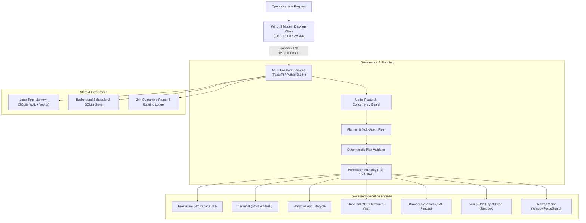

# NEXORA v1.0

> **Production Autonomous Intelligence Platform for Windows**  
> *Models propose. Deterministic software validates, authorizes, executes, and verifies.*

```text
╔══════════════════════════════════════════════════════════════════════╗
║  NEXORA v1.0 Production Release                                      ║
║  Native WinUI 3 Control Plane · Local Models · Governed Execution    ║
╚══════════════════════════════════════════════════════════════════════╝
```

NEXORA is a **local-first, fail-closed autonomous intelligence platform** engineered specifically for Windows laptops and workstations. It translates high-level natural language goals into deterministic, verified local actions using local Ollama model instances (`qwen3.5:9b`, `llama3.1:8b`), an isolated Python 3.14+ FastAPI backend engine, and a high-performance modern WinUI 3 desktop application (.NET 8).

---

## Architecture & System Overview



---

## 14-Phase Capability Matrix

| Phase | Subsystem | Description | Status |
| :--- | :--- | :--- | :--- |
| **0** | **Workspace Scaffolding** | Strict project layout, isolation bounds, and reproducible Python 3.14+ environment. | Completed |
| **1** | **Local Model Engine** | Ollama integration, GPU inference concurrency guard, streaming, and error handling. | Completed |
| **2** | **Task Engine & State** | Finite state machine, structured execution plans, and human approval gates. | Completed |
| **3** | **Governed Tool Ecosystem**| Sandboxed filesystem, tokenized terminal runner, and Windows application supervisor. | Completed |
| **4** | **Model Router & Profiler**| Dynamic latency calibration, benchmark profiler, and task complexity routing. | Completed |
| **5** | **WinUI 3 Desktop Host** | Modern Fluent UI desktop control plane, task composer, and execution timeline. | Completed |
| **6** | **Multi-Agent Fleet** | DAG-based task coordinator, specialized agent roles, and artifact pipelines. | Completed |
| **7** | **Dynamic Skill System** | Extensible markdown skills, GitHub discovery, semantic versioning, and XML prompts. | Completed |
| **8** | **Universal MCP Platform** | Model Context Protocol client, stdio server lifecycle, and encrypted secrets vault. | Completed |
| **9** | **Browser Research** | Isolated web search, page scraping, anti-prompt injection fencing, and quarantine. | Completed |
| **10**| **Dynamic Code Sandbox** | AST security validator, Win32 Job Object process quotas, and trial evidence. | Completed |
| **11**| **Long-Term Memory** | SQLite FTS5 lexical search, semantic embeddings, and automated secret scrubbing. | Completed |
| **12**| **Desktop Vision & UI** | UIA automation tree inspection, target window focus guard, and privacy shielding. | Completed |
| **13**| **Background Scheduler** | Cron/interval schedules, atomic SQLite leases, idempotency, and desktop UI drawer. | Completed |
| **14**| **Hardening & Release** | Diagnostics doctor, sanitized bundle export, backup/restore, and security audit. | Completed |

---

## Quick Start Guide

### 1. Automated Setup
On a clean checkout of the repository, execute:
```powershell
.\scripts\bootstrap.ps1
```

### 2. Start the Backend Engine
```powershell
.\start_server.bat
```
The backend initializes SQLite WAL databases, long-term memory, and starts listening on `http://127.0.0.1:8000`.

### 3. Launch WinUI 3 Desktop Application
```powershell
dotnet run --project desktop/Nexora.Desktop/Nexora.Desktop.csproj
```

---

## Operational Scripts

NEXORA provides a complete suite of native PowerShell automation scripts in `scripts/`:

* **`scripts/doctor.ps1`**: Pre-flight diagnostics checking Python 3.14+, .NET 8, Ollama, Win32 Job Objects, and SQLite WAL storage.
* **`scripts/export-diagnostics.ps1`**: Assembles a sanitized support bundle (`diagnostics/`) with system metrics and secret-scrubbed logs.
* **`scripts/security-audit.ps1`**: Executes supply chain audits, adversarial security tests, and validates `docs/SBOM.json`.
* **`scripts/backup.ps1`**: Checkpoints SQLite WAL logs (`PRAGMA wal_checkpoint(TRUNCATE)`) and generates an atomic backup ZIP with SHA-256 hash.
* **`scripts/restore.ps1`**: Validates checksums, tests database integrity, and restores state with automatic rollback protection.
* **`scripts/uninstall-clean.ps1`**: Safely purges state data (`DataOnly` mode) or resets build artifacts (`FactoryReset` mode).
* **`scripts/run-all-tests.ps1`**: Runs the complete tiered test runner (328 backend tests + 49 desktop tests + WinUI 3 build). Add `-IncludeLive` for live local Ollama testing.

---

## Documentation

* [**Deployment Guide**](file:///d:/Projects/Works/Nexora/docs/DEPLOYMENT_GUIDE.md): Detailed installation, hardware recommendations, and setup.
* [**Security Audit & Threat Model**](file:///d:/Projects/Works/Nexora/docs/SECURITY_AUDIT.md): STRIDE threat analysis, trust boundaries, and controls.
* [**Backup & Recovery Guide**](file:///d:/Projects/Works/Nexora/docs/BACKUP_RECOVERY.md): SQLite WAL checkpointing, recovery runbooks, and lifecycle.
* [**Test Verification Matrix**](file:///d:/Projects/Works/Nexora/docs/TEST_MATRIX.md): Detailed 4-tier capability classification and test gates.
* [**Release Notes**](file:///d:/Projects/Works/Nexora/RELEASE_NOTES.md): v1.0.0 release notes and hardware/model compatibility matrix.

---

## License & Compliance

NEXORA is released under the MIT License. See [docs/SBOM.json](file:///d:/Projects/Works/Nexora/docs/SBOM.json) for the complete Software Bill of Materials.
